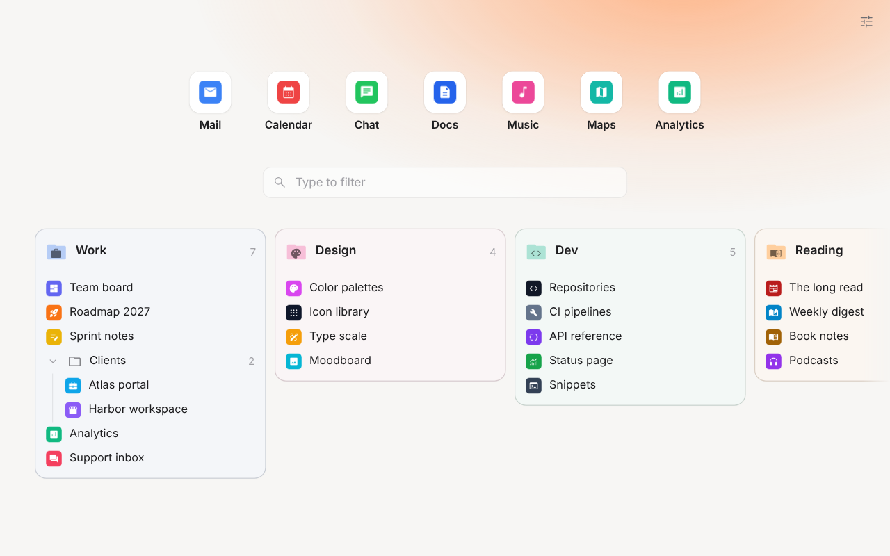
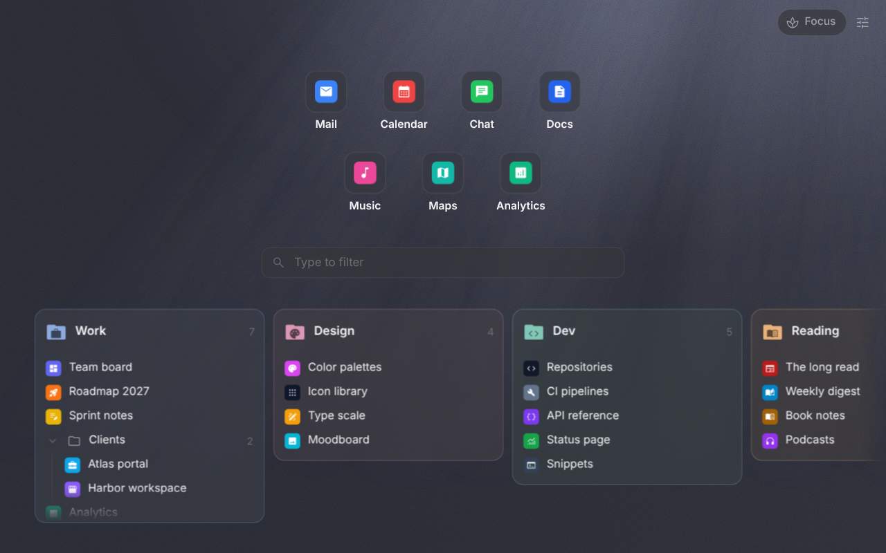
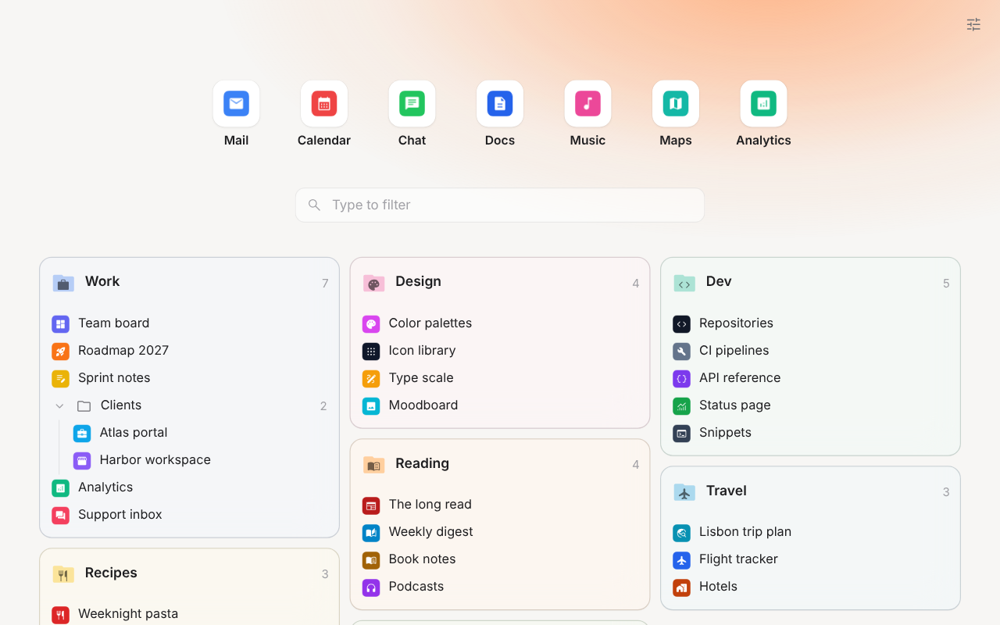
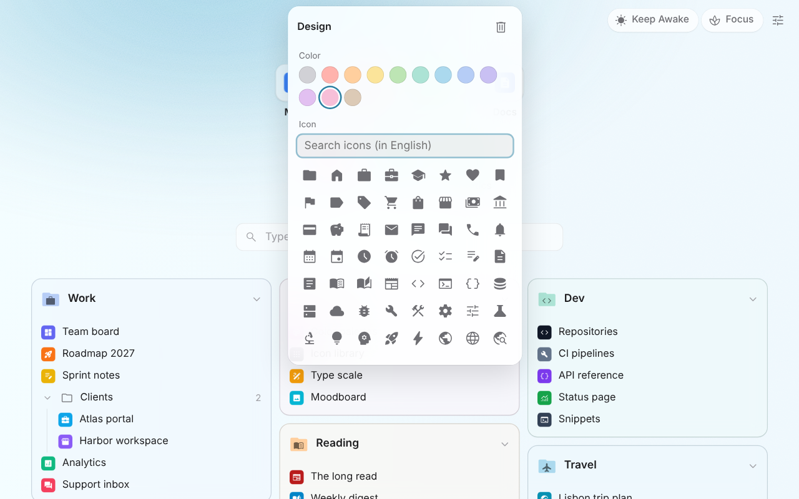
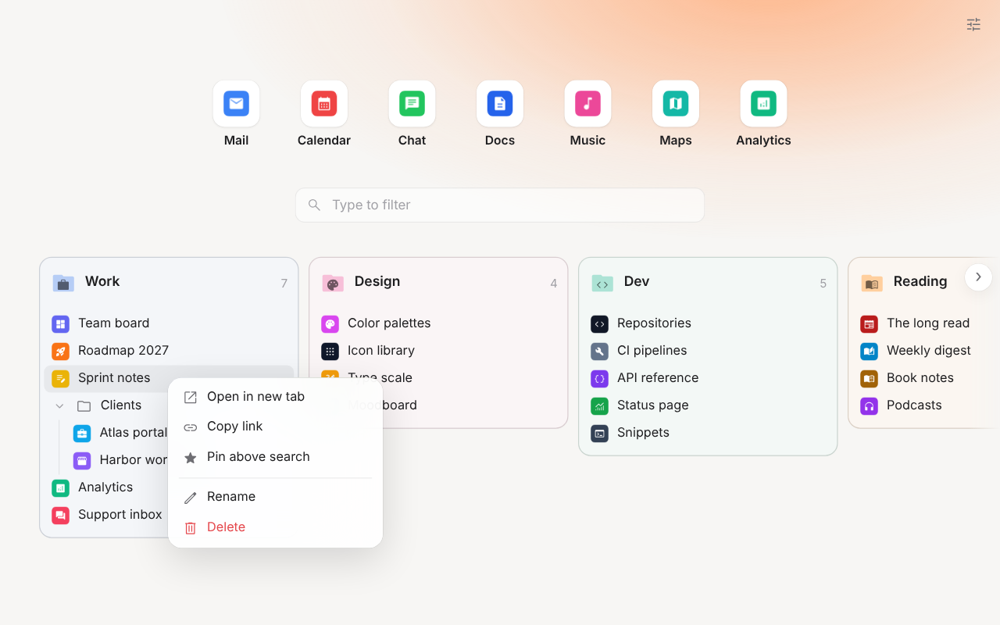
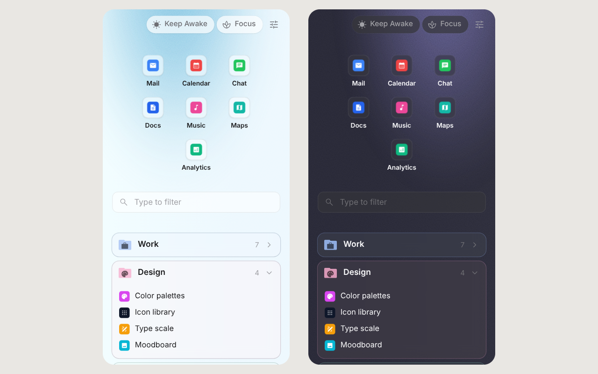

# ReStart

**A calm, simple start page built around your bookmarks, in their real order. As it always should have been.**

ReStart replaces the new tab page of Firefox (version 140 or later) and of Chromium-based browsers that let extensions do so (Brave, Chrome, Edge…, version 116 or later) with a macOS-inspired start page built from your existing bookmarks bar. No feeds, no widgets, no distractions. No account, no server, no tracking, no network requests.



<table>
  <tr>
    <td></td>
    <td></td>
  </tr>
  <tr>
    <td align="center">Dark mode, light rays</td>
    <td align="center">Mosaic layout</td>
  </tr>
  <tr>
    <td></td>
    <td></td>
  </tr>
  <tr>
    <td align="center">Folder color and icon</td>
    <td align="center">Right-click menu</td>
  </tr>
</table>

<p align="center"></p>
<p align="center">Narrow windows</p>

## Features

- **Your bookmarks, as you organized them.** Folders of the bookmarks bar become columns, in the exact order you set (never alphabetical). Subfolders expand in place. *Other bookmarks* get their own column when they contain bookmarks. Empty folders are hidden (they appear, disabled, in the settings' column list).
- **Sites outside folders** appear as tiles above the search bar. Past 20, they move into a wide, scrollable card, and you can pin the ones you want to keep on top. Any bookmark from a folder or subfolder can also be pinned above the search bar from the right-click menu; it stays in its folder as well.
- **Two layouts** for wide windows: *Board* (horizontal columns, Trello-style) or *Mosaic* (cards filling the width, Google Keep-style). Narrow windows show a compact list of collapsible folders.
- **Instant filter.** Type in the search bar to filter bookmarks by title or URL; once the page has focus, typing anywhere on it works too. When a single result is left, press Enter to open it.
- **Folder icons and colors.** Give each top-level folder a pastel color and a symbol (Material Symbols).
- **Right-click actions** on any bookmark: open in a new tab, copy link, pin above the search bar, rename, delete. On a *Most visited* site: add it to your bookmarks, in the bookmarks bar, one of its folders or a new folder. On a folder's header or a subfolder: rename or delete the folder.
- **Reorder or hide columns** by dragging their header or from the settings. This only affects ReStart, never your bookmarks.
- **Most visited** column, optional. Right-click a site there to add it to your bookmarks, which helps build the page from your browsing habits, even when starting with no bookmarks.
- **Appearance:** light and dark mode follow the system, or can be fixed to light or dark. Background: none, a plain color (a pastel or any custom color), a halo, or rays (diffuse shafts of light, like sunlight under water). The halo and the rays come in 10 preset colors or any custom color, with adjustable intensity and an optional color underneath (a pastel or any custom color); they move with the sun, from the left in the morning to the right in the evening, change color with the time of day, and are gently animated (optional, and off when the system asks for reduced motion). An optional warmer tint in the evening goes with the plain backgrounds. Column opacity is adjustable.
- **Site icons** from the browser, with a colored letter when there is none. Chromium-based browsers provide icons from their favicon cache. Firefox gives extensions no access to that cache, so ReStart uses the icons Firefox returns with your most visited sites (up to 100), matched by site; other bookmarks show a colored letter. Nothing is ever downloaded.
- **Export and import** of your customizations (icons, colors, order, hidden columns, pinned sites, appearance) as a JSON file, to back them up or move them to another device. Customizations are stored on the device only.
- **7 languages:** English, French, Spanish, Portuguese (Brazil and Portugal), Dutch, Italian, German.

## Install

### From the stores

- Chrome Web Store (Brave, Chrome, Edge…): *coming soon.*
- Firefox Add-ons: *coming soon.*

### From source

Brave, Chrome, Edge…:

1. Download or clone this repository.
2. Open `brave://extensions` (or `chrome://extensions`) and turn on **Developer mode**.
3. Click **Load unpacked** and select the `src` folder.
4. Open a new tab. If the browser asks whether to keep the new tab page change, confirm.

Firefox:

1. Run `sh build.sh` (it creates `dist/firefox/`).
2. Open `about:debugging#/runtime/this-firefox` and click **Load Temporary Add-on…**.
3. Select `dist/firefox/manifest.json`. A temporary add-on stays installed until Firefox restarts.

## Permissions

| Permission | Why |
|---|---|
| `bookmarks` | Read your bookmarks to display them; rename, delete or add a bookmark, or rename, create or delete a folder, when you ask from the right-click menu. |
| `favicon` | Chromium-based browsers only: show site icons from the browser's favicon cache. |
| `storage` | Save settings and folder customizations, on the device only. |
| `topSites` | Show the optional *Most visited* column. In Firefox, also provides the icons of the most visited sites. |

See [PRIVACY.md](PRIVACY.md) for details, and [SECURITY.md](SECURITY.md) for how untrusted data is handled.

## Project structure

```
src/                  The extension, shared by all browsers (load this folder in Chromium)
  manifest.json       Chromium manifest; its "version" is the version of both builds
  newtab.html         New tab page
  theme-boot.js       Applies the theme before the first paint
  app.js              Page logic
  styles.css
  icons.js            Embedded Material Symbols (subset)
  _locales/           Translations
store/                Chrome Web Store listing texts, permission justifications,
                      screenshots (1280x800), an extra narrow-window screenshot,
                      promo tiles and store icon; firefox.md for addons.mozilla.org
platforms/firefox/    Firefox manifest
build.sh              Builds dist/restart-chrome-<version>.zip and dist/restart-firefox-<version>.zip
.github/workflows/    Release workflow: builds the zips and attaches them to each GitHub release
```

Plain HTML, CSS and JavaScript (ES modules), no compilation. `build.sh` only copies `src/` and picks the manifest for each browser. To release a new version:

1. Change `version` in `src/manifest.json`.
2. Publish a GitHub release with the tag `v<version>` (for example `v1.0.1`). The *Release packages* workflow (`.github/workflows/release.yml`) checks that the tag matches the version, runs `build.sh` and attaches both zips to the release. You can also run `sh build.sh` locally.
3. Upload each zip to its store.

## Contributing

Issues and pull requests are welcome. Translations live in `src/_locales/<lang>/messages.json`; to add a language, copy `en/messages.json` and translate the `message` values.

## License

[MIT](LICENSE). Icons: [Material Symbols](https://fonts.google.com/icons) by Google, under the Apache License 2.0 (see `src/LICENSE-material-symbols.txt`).
