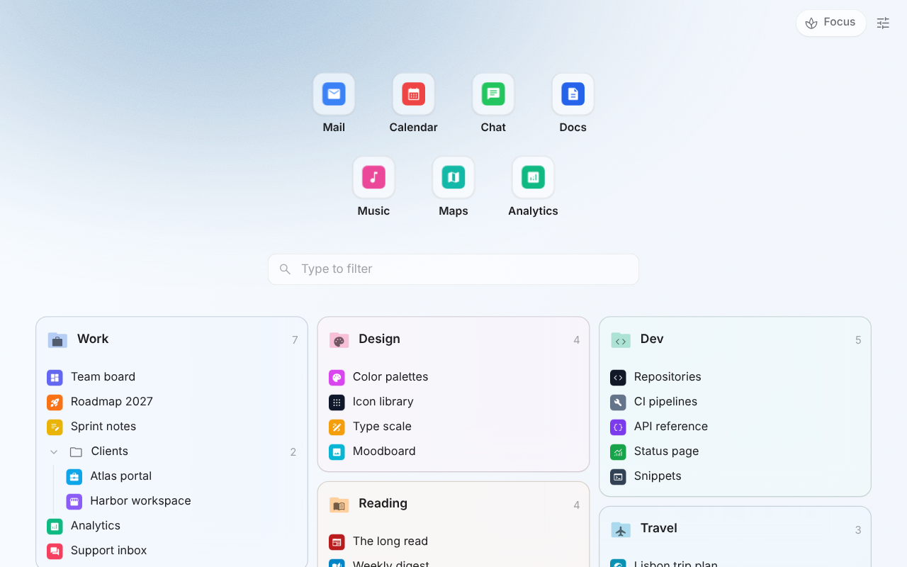
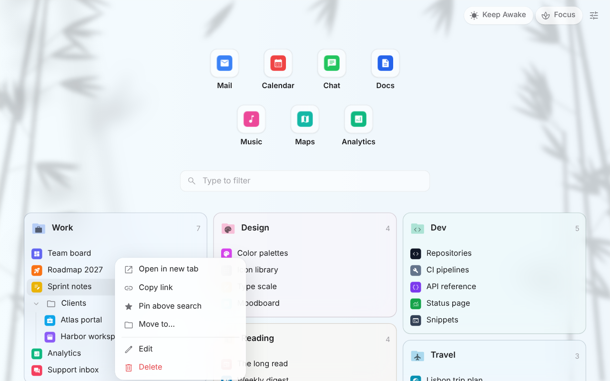
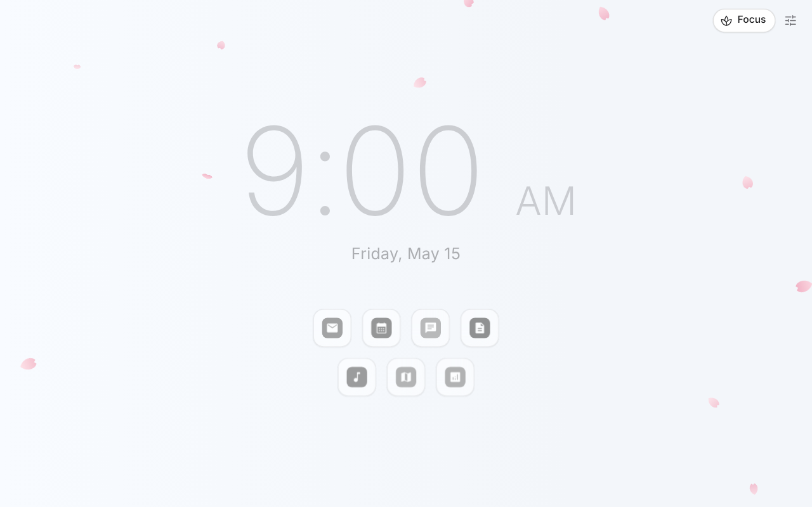
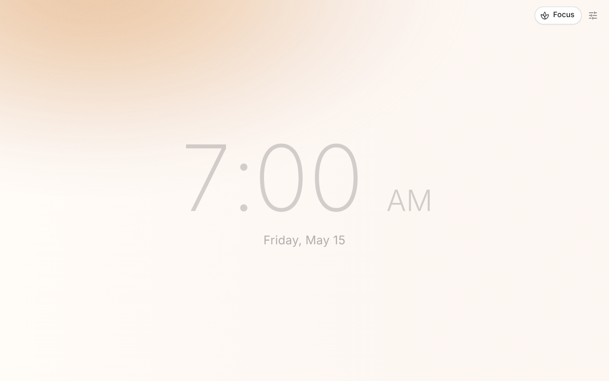
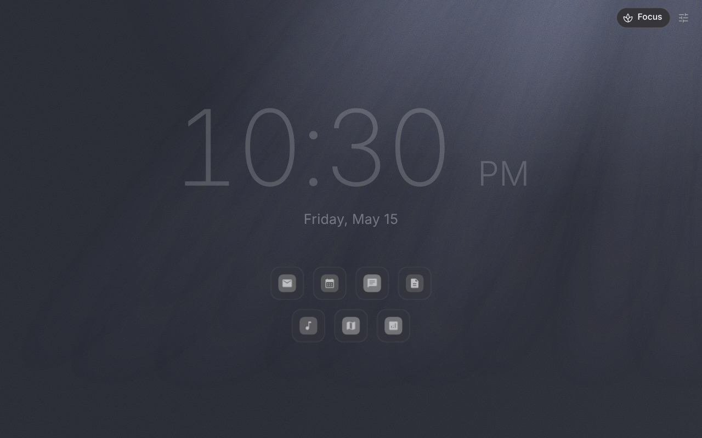
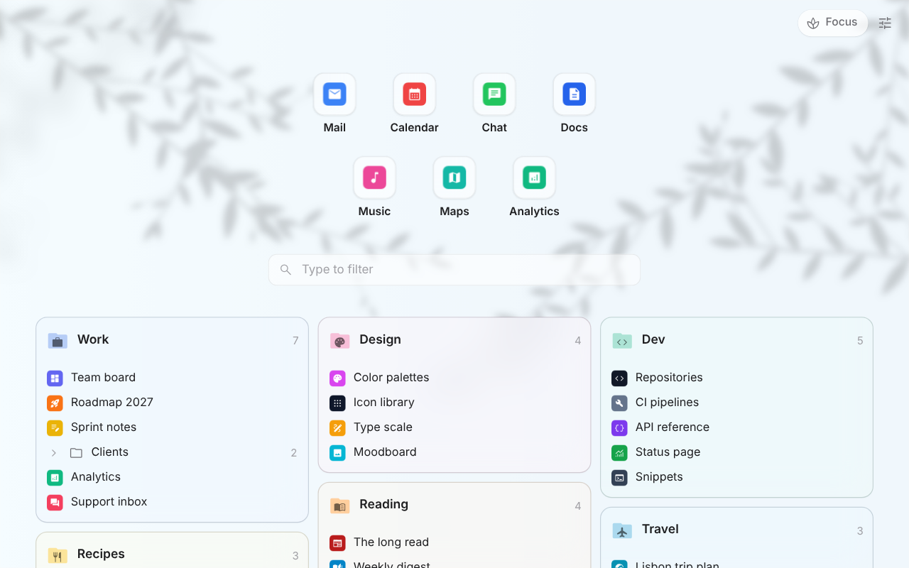
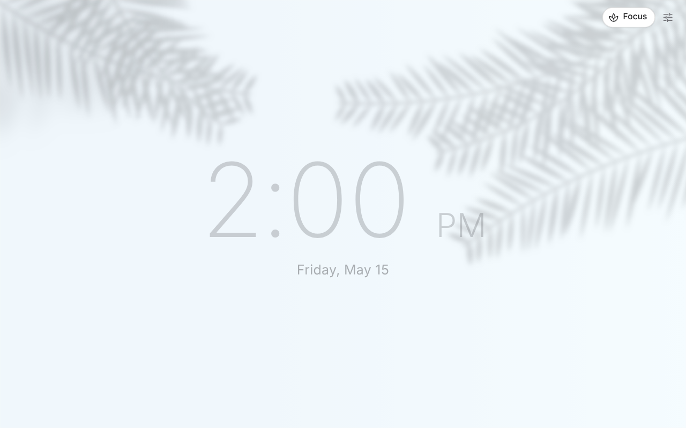
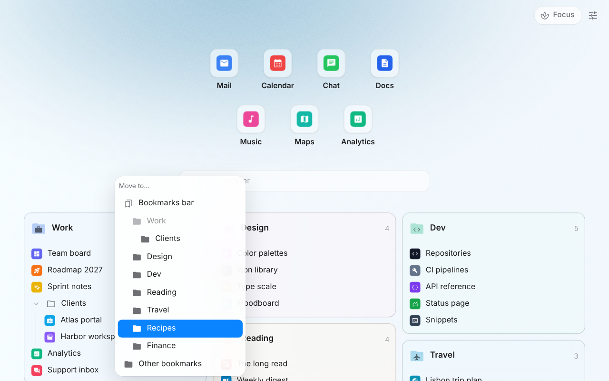
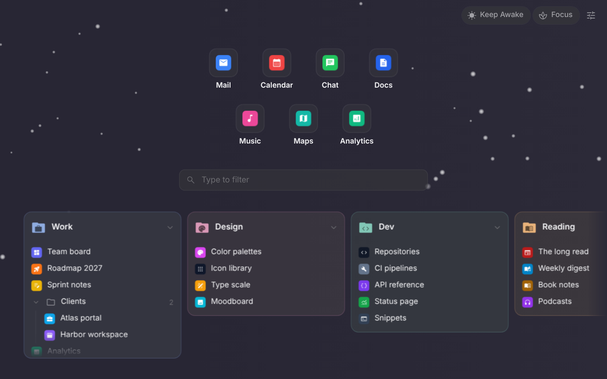

# ReStart

**A calm, simple start page built around your bookmarks, in their real order. As it always should have been.**

ReStart replaces the new tab page of Firefox (version 140 or later) and of Chromium-based browsers that let extensions do so (Brave, Chrome, Edge…, version 116 or later) with a macOS-inspired start page built from your existing bookmarks bar. No feeds, no widgets, no distractions. No account, no server, no tracking, no network requests.



<table>
  <tr>
    <td></td>
    <td></td>
  </tr>
  <tr>
    <td align="center">Board layout, dark mode, rays</td>
    <td align="center">Right-click menu, bamboo shadows</td>
  </tr>
  <tr>
    <td></td>
    <td></td>
  </tr>
  <tr>
    <td align="center">Folder color and icon</td>
    <td align="center">Focus mode, breeze of petals</td>
  </tr>
</table>

<table>
  <tr>
    <td></td>
    <td></td>
  </tr>
  <tr>
    <td align="center">Focus mode, morning halo</td>
    <td align="center">Focus mode with site icons, night rays</td>
  </tr>
  <tr>
    <td></td>
    <td></td>
  </tr>
  <tr>
    <td align="center">Branch shadows</td>
    <td align="center">Focus mode, palm shadows</td>
  </tr>
  <tr>
    <td></td>
    <td></td>
  </tr>
  <tr>
    <td align="center">Move to another folder</td>
    <td align="center">Breeze of snow</td>
  </tr>
</table>

<p align="center"></p>
<p align="center">Narrow windows</p>

## Features

- **Your bookmarks, as you organized them.** Folders of the bookmarks bar become columns, in the exact order you set (never alphabetical). Subfolders expand in place. Drag a bookmark or a subfolder to reorder it, or to move it to another folder: drop it between two bookmarks, on a column, in the middle of a subfolder's row, or on the row of tiles (bookmarks bar). The right-click menu also offers *Move to…*, with a list of all folders. Everything moves in your browser's bookmarks, like a rename or a delete; ReStart keeps no order of its own. A folder can't be moved into itself. *Other bookmarks* get their own column when they contain bookmarks. Empty folders are hidden (they appear, disabled, in the settings' column list). Long folders keep a fixed height and scroll inside, with a soft fade at the bottom, so a folder of 100 sites never makes the page endless.
- **Sites outside folders** appear as tiles above the search bar: up to 6 on one row, then balanced rows of at most 8, so the block stays easy to scan. Past 20, they move into a wide, scrollable card, and you can pin the ones you want to keep on top. Any bookmark from a folder or subfolder can also be pinned above the search bar from the right-click menu; it stays in its folder as well. Drag the tiles (or use *Move left* / *Move right* in the right-click menu) to reorder them: sites of the bookmarks bar move in the bar itself; pinned sites only change their order among pins.
- **Two layouts** for wide windows: *Mosaic* (cards filling the width, Google Keep-style, the default) or *Board* (horizontal columns, Trello-style). Narrow windows show a compact list of collapsible folders.
- **Instant filter.** Type in the search bar to filter bookmarks by title or URL; once the page has focus, typing anywhere on it works too. When a single result is left, press Enter to open it.
- **Folder icons and colors.** Give each top-level folder a pastel color and a symbol (Material Symbols).
- **Right-click actions** on any bookmark: open in a new tab, copy link, pin above the search bar, move to another folder, rename, delete. On a *Most visited* site: add it to your bookmarks, in the bookmarks bar, one of its folders or a new folder. On a folder's header or a subfolder: rename or delete the folder, or move it to another folder.
- **Focus mode.** The *Focus* button next to the settings hides everything but the background: for a calm tab, or a screen shared during a demo. It stays on in every new tab until you turn it off. Options: the time and date in large, faint type (automatic, 12-hour or 24-hour format), and the sites above the search bar kept as icons, without names or tooltips, in soft gray by default (they regain their color on hover), in balanced rows. Every background works in Focus mode, the breeze included: it then lands on the clock and the icons.
- **Reorder or hide columns** by dragging their header or from the settings. Moving a folder's column moves the folder in your bookmarks bar. The columns that are not folders of the bar (*Most visited*, *Other bookmarks*, the card of bar sites) keep the place you give them, which ReStart remembers. Hiding a column only affects ReStart.
- **Most visited** column, optional. Right-click a site there to add it to your bookmarks, which helps build the page from your browsing habits. When it would be the only column (no folder with bookmarks, and the bar's sites fit above the search bar), it becomes a wide card of up to 20 sites, in two balanced rows. With fewer than 3 bookmarks, a short hint explains how to fill the page.
- **Appearance.** Light and dark mode follow the system, or can be fixed to light or dark. Background: a color (by default one that follows the hour, marked with a small sun), light (a halo, or rays: diffuse shafts of light, like sunlight under water, swaying slowly), leaf shadows (branches, palm fronds or bamboo on a softly tinted wall, moved by a wind that turns now and then, with gusts and calm stretches, never a regular back-and-forth) or breeze (snow, cherry petals, dandelion seeds or autumn leaves drifting in a gusting wind, fading where they land on cards, tiles and the search bar; *Season*, the default, picks them by the date: petals in spring, seeds in summer, leaves in autumn, snow in winter; drawn on one canvas, paused when the tab is hidden). The halo and the rays follow the sun: they move from the left in the morning to the right in the evening. With the default color, *Sky*, they follow the height of the sun: a soft slate blue at night, rose then gold as the sun rises, a whitening light, then a clear sky at midday, and the same colors in mirror until dusk. Sky also follows the seasons (northern hemisphere, without asking for your location): sunrise and sunset move with the date, and winter light is softer and greyer than summer light. The other colors keep their hue, paler at midday and softer at night. Both have two tones (a core and a neighbouring fringe), a smooth falloff with no visible edge, and a faint fixed grain that avoids banding. A color you choose never changes. Light, leaf shadows and breeze have an adjustable intensity (for the breeze, how many things drift; the light is a little stronger by default than before 1.2.1), a page color underneath that follows the hour (or one you choose) and an adjustable *Motion* speed, from still to twice the normal pace (everything stands still when the system asks for reduced motion). Colors: *Sky* (marked with a small sun) and 10 fixed presets for the halo and the rays, a very light neutral gray and pastels for backgrounds, or any color with ReStart's own color picker (hex code, hue, shade), the same in every browser. Column opacity is adjustable.
- **Site icons** from the browser, with a colored letter when there is none. Chromium-based browsers provide icons from their favicon cache. Firefox gives extensions no access to that cache, so ReStart uses the icons Firefox returns with your most visited sites (up to 100), matched by site; other bookmarks show a colored letter. Nothing is ever downloaded.
- **Export and import** of your customizations (folder icons and colors, hidden columns, pinned sites and their order, the place of the extra columns, appearance, focus mode) as a JSON file, to back them up or move them to another device. The file holds how ReStart shows your bookmarks, not the bookmarks themselves: your browser saves those, with its sync or its bookmark export. Folders are matched by name. After an import, ReStart says what was restored, which folders of the file it could not find, and which current folders the file does not know (they keep their default look). Customizations are stored on the device only.
- **A short welcome** on the first new tab: three lines on what ReStart does, closed with *Get started*, the close button or Esc. It does not come back; *Show the introduction again* in the settings displays it again.
- **7 languages:** English, French, Spanish, Portuguese (Brazil and Portugal), Dutch, Italian, German.

## Install

### From the stores

- Chrome Web Store (Brave, Chrome, Edge…): *coming soon.*
- Firefox Add-ons: *coming soon.*

### From source

Brave, Chrome, Edge…:

1. Download or clone this repository.
2. Open `brave://extensions` (or `chrome://extensions`) and turn on **Developer mode**.
3. Click **Load unpacked** and select the `src` folder.
4. Open a new tab. If the browser asks whether to keep the new tab page change, confirm.

Firefox:

1. Run `sh build.sh` (it creates `dist/firefox/`).
2. Open `about:debugging#/runtime/this-firefox` and click **Load Temporary Add-on…**.
3. Select `dist/firefox/manifest.json`. A temporary add-on stays installed until Firefox restarts.

## Permissions

| Permission | Why |
|---|---|
| `bookmarks` | Read your bookmarks to display them; rename, move, delete or add a bookmark, or rename, move, create or delete a folder, when you ask (right-click menu, or dragging to reorder). |
| `favicon` | Chromium-based browsers only: show site icons from the browser's favicon cache. |
| `storage` | Save settings and folder customizations, on the device only. |
| `topSites` | Show the optional *Most visited* column. In Firefox, also provides the icons of the most visited sites. |

See [PRIVACY.md](PRIVACY.md) for details, and [SECURITY.md](SECURITY.md) for how untrusted data is handled. What changed in each version is in [CHANGELOG.md](CHANGELOG.md).

## Project structure

```
src/                  The extension, shared by all browsers (load this folder in Chromium)
  manifest.json       Chromium manifest; its "version" is the version of both builds
  newtab.html         New tab page
  theme-boot.js       Applies the theme before the first paint
  app.js              Page logic
  styles.css
  icons.js            Embedded Material Symbols (subset)
  img/                Icons and the leaf-shadow drawings (SVG)
  _locales/           Translations
store/                Chrome Web Store listing texts, permission justifications,
                      screenshots (1280x800), extra screenshots (narrow window, focus mode, leaf shadows, breeze, move to),
                      promo tiles and store icon; firefox.md for addons.mozilla.org
platforms/firefox/    Firefox manifest
tools/                Scripts that draw the leaf shadows: original drawings, generated (python3 tools/bamboo.py)
CHANGELOG.md          What changed in each version
build.sh              Builds dist/restart-chrome-<version>.zip and dist/restart-firefox-<version>.zip
.github/workflows/    Release workflow: builds the zips and attaches them to each GitHub release
```

Plain HTML, CSS and JavaScript (ES modules), no compilation. `build.sh` only copies `src/` and picks the manifest for each browser. To release a new version:

1. Change `version` in `src/manifest.json` and add the version's notes to [CHANGELOG.md](CHANGELOG.md).
2. Publish a GitHub release with the tag `v<version>` (for example `v1.2.1`). The *Release packages* workflow (`.github/workflows/release.yml`) checks that the tag matches the version, runs `build.sh` and attaches both zips to the release. You can also run `sh build.sh` locally.
3. Upload each zip to its store.

## Contributing

Issues and pull requests are welcome. Translations live in `src/_locales/<lang>/messages.json`; to add a language, copy `en/messages.json` and translate the `message` values.

## License

[MIT](LICENSE). Icons: [Material Symbols](https://fonts.google.com/icons) by Google, under the Apache License 2.0 (see `src/LICENSE-material-symbols.txt`).
